# MiHAIP (MiHAIP-master) — Full Workflow (all Java classes)

MiHAIP predicts **minor histocompatibility antigens (MiHAs)** for a
donor/recipient (D/R) transplant pair. It compares two genome VCFs, annotates
coding changes, builds mutant vs reference peptides, models proteasomal
cleavage, predicts HLA binding, and reports candidate immunogenic peptides with
population allele frequencies.

> Source note: this summary is derived from the `.java` sources in `MiHAIP/src`
> (packages `analysis`, `clevage`, `command`, `database`, `nmdp`, `translate`,
> `util`; 37 files). No build file (Maven/Gradle) is present.
> One class referenced by the code, `analysis.Patient`, is missing from the tree
> (see Caveats).

---

## 1. Entry point and the 8-step pipeline (`nmdp.Launcher`)

`Launcher.main` parses CLI flags, populates `Configure`, builds the output
folder tree (`FileHelp.makeFolders`), and then runs either one step (`-s N`) or
all 8 steps in order.

CLI flags: `-d` donor VCF (`.vcf.gz`, indexed), `-r` recipient VCF, `-pid` pair id,
`-hla` 6 alleles (e.g. `A02:01,A02:01,B07:02,B14:02,C07:02,C08:02`),
`-t` tool folder (default `/home/wwang/Tools/`), `-o` output folder, `-s` step,
`-sex` MM/MF/FM/FF (donor then recipient), `-h` help.

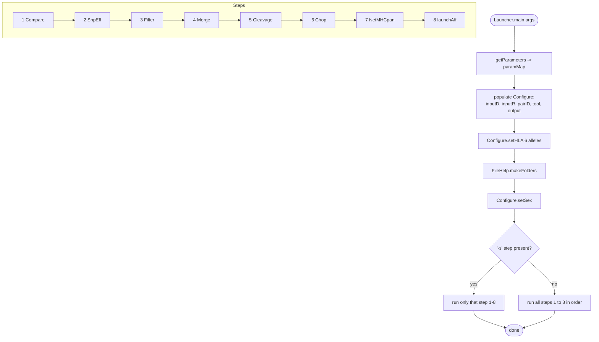

---

## 2. End-to-end data flow

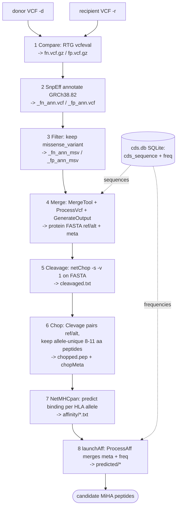

---

## 3. Step-by-step (command layer)

### Step 1 — `command.Compare`
Builds and runs an RTG Tools `vcfeval` command (via `util.Executor`) comparing
donor `-b` vs recipient `-c`, writing fn/fp VCFs under `compared/<pid>.out`.
`Executor` waits for the process but does not read its output.

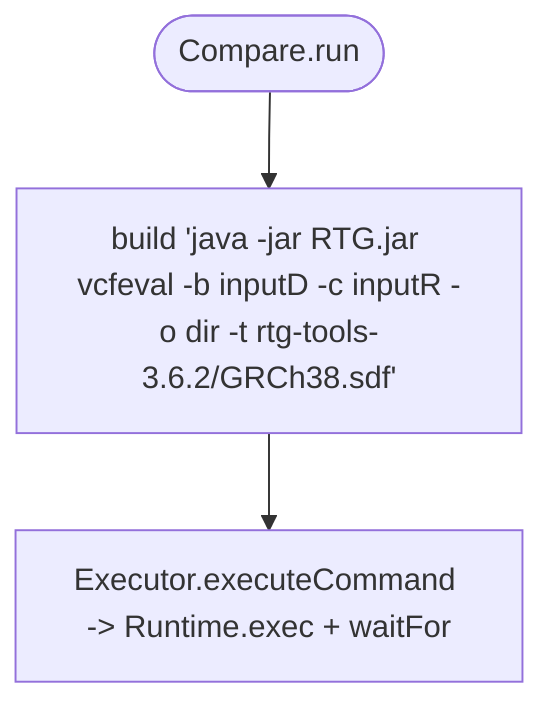

### Step 2 — `command.SnpEff`
Annotates both fp and fn VCFs with SnpEff (`GRCh38.82`, `-t -canon -onlyProtein`),
capturing stdout to annotated VCFs via `CommandHelper.runAndSave`. GRCh37.75
variants exist only as commented-out lines.

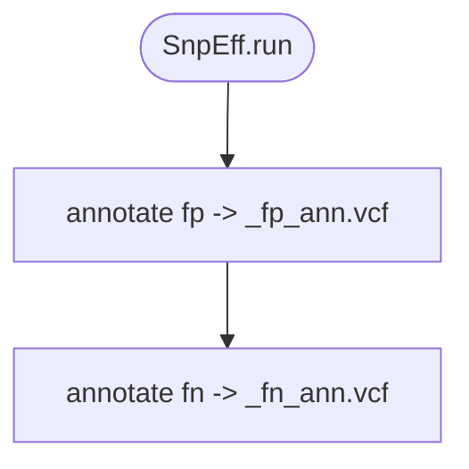

### Step 3 — `command.Filter`
Keeps only lines containing `missense_variant` from each annotated VCF (header
lines are dropped as well, since they lack that string).

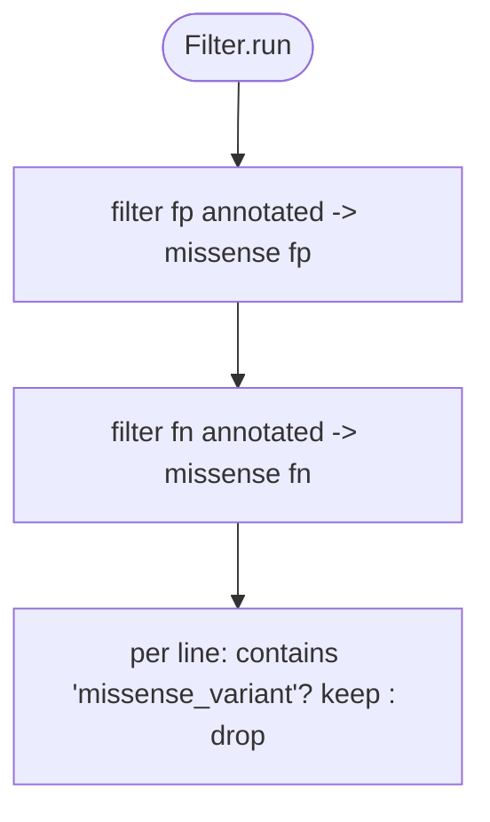

### Step 4 — `command.Merge` (the analysis core)
Merges fp+fn missense variants, parses them into transcripts, and generates
ref/alt protein FASTA + metadata. Uses the SQLite DB for CDS sequences.

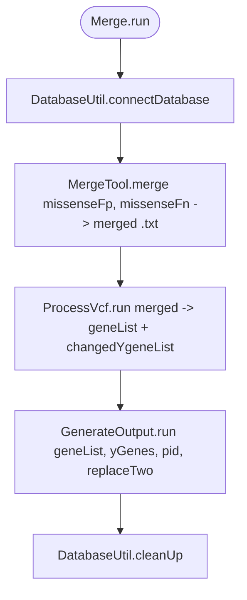

### Step 5 — `command.Cleavage`
Runs netChop (`netchop-3.1/bin/netChop -s -v 1`) on the protein FASTA to predict
proteasomal cleavage sites; output saved to the cleavaged file. The Y-protein
cleavage block is commented out.

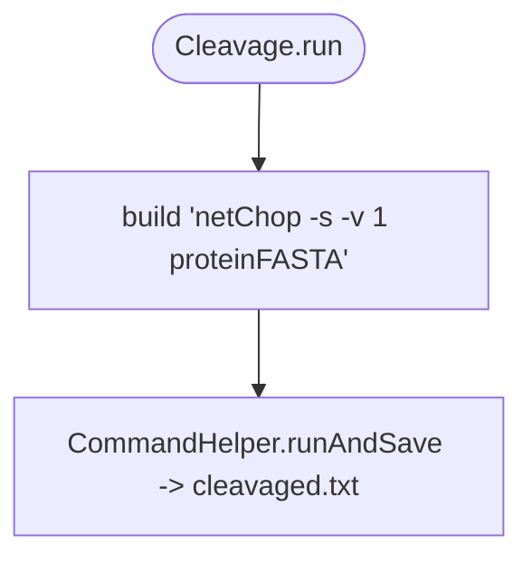

### Step 6 — `command.Chop`
Delegates to `clevage.Clevage` to cut the cleavage output into allele-unique
8-11 aa peptides (see section 6).

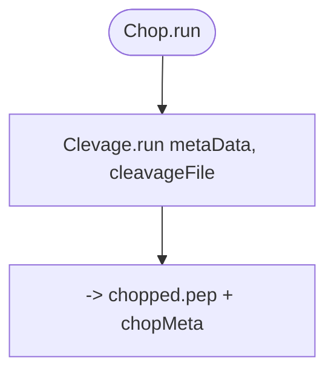

### Step 7 — `command.NetMHCpan`
Generates a bash script that runs `netMHCpan-3.0/netMHCpan -p -a <HLA>` for every
configured HLA allele (A/B/C, 1 or 2 each) against the peptide file in parallel
(`&` + `wait`), then executes it via `CommandHelper.runBash`.

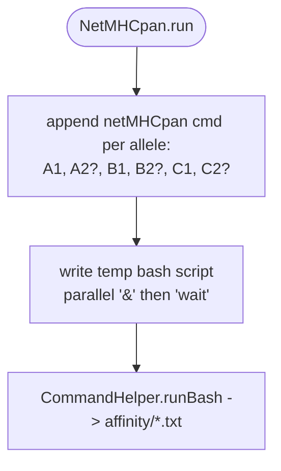

### Step 8 — `command.launchAff`
For each HLA allele file, `analysis.ProcessAff` interleaves the chop metadata
(with injected frequencies) and the netMHCpan predictions into final output.

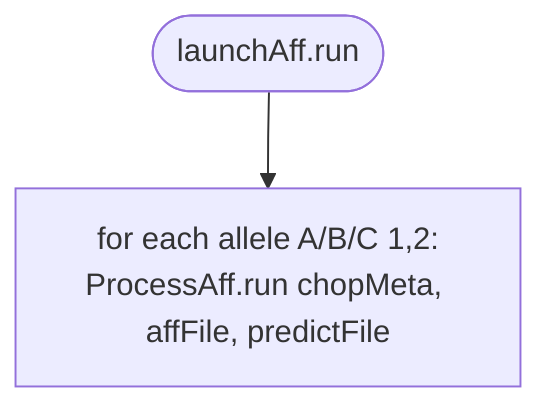

---

## 4. Analysis layer

### `analysis.MergeTool`
Merges fp and fn missense variants into per-chromosome lists (24 lists), tags
each record with a `Patient` (`Donor` / `Reciepor`), resolves overlapping
positions (same position with different alleles keeps the record with ref and alt
swapped), and writes the result sorted by chromosome and position.

### `analysis.ProcessVcf`
Parses the SnpEff `ANN` field of the merged file into `Transcript` objects
(first ENST per line plus the first `ENST...p.` match), records the CDS position
of each change, and flags Y transcripts when sex is FM. It depends on exact `ANN`
field positions (`detail[3]`, `detail[6]`, `detail[9]`).

### `analysis.GenerateOutput` (ref/alt peptide builder)

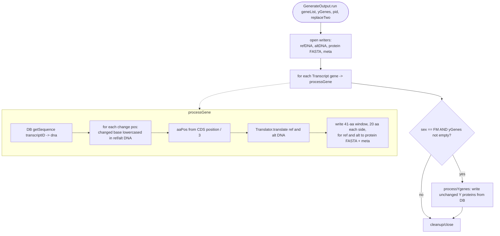

Meta file: one line `chr,pos,ref,alt,cdsPos,transcript,` then the residue index
inside the window on the next line.

### `analysis.ProcessAff` (final merge of predictions + frequencies)
Combines NetMHCpan output, chop metadata, and DB frequencies (ref/alt base; `NA`
if missing) into the final comma-separated prediction tables.

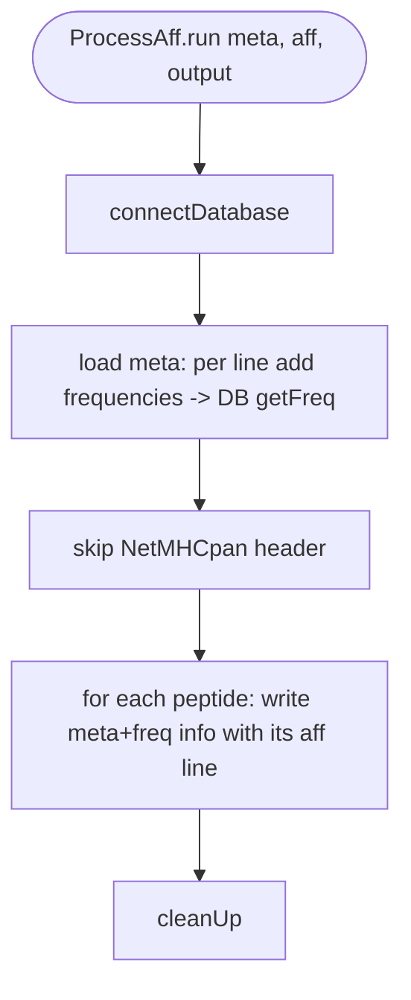

### Model classes
- `analysis.Transcript` — one affected transcript: ID/gene/chrome/pos/ref/alt/patient + map of CDS position -> alt base; builds the FASTA header.
- `analysis.Gene` — gene holding a map of `Transcript`s (not used by the pipeline).
- `analysis.SNPdata` — one VCF record (chrome, pos, ref, alt, raw line, patient); `Comparable` by chromosome/position, can swap ref and alt (X->23, Y->24).
- `analysis.NT` — enum A/T/G/C (unused).

---

## 5. Translation (`translate.Translator`)

A 64-codon DNA->amino-acid table. `translate(dna, frame, lowcase)` walks codons
in steps of 3 and lowercases the amino acids at the flagged change positions.
`dna2aa` falls back to the 4-fold-degenerate first-two-base rule, else `X`.

---

## 6. Peptide chopping (`clevage` package)

- `clevage.Clevage` — reads metadata and netChop output, pairs ref/alt sequences per locus, finds cleavage sites (`S` in the NetChop line), takes site pairs giving 8-11 aa peptides that cover the mutated residue, removes peptides shared by ref and alt, and writes the `.pep` file plus a parallel metadata file. Pairs with identical ref and alt sequences are skipped.
- `clevage.PairData` — holds a locus pair (id, seq1, cle1, seq2, cle2).

---

## 7. Database layer (`database` package, SQLite `cds.db`)

`DatabaseUtil` is the JDBC gateway (`org.sqlite.JDBC`, `cds.db` in the working
directory). Two tables: `cds_sequence` (ID, Chrome, Gene_Symbol, Description,
transcript ID, SEQ) and `freq` (ID, Chrome, position, A, T, C, G).

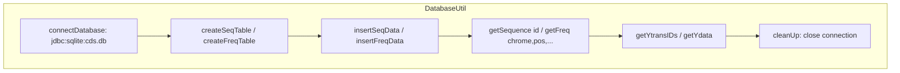

Runtime consumers: `GenerateOutput` and `ProcessAff` read sequences/frequencies.
Note: queries build SQL by string concatenation (`wrapString`, `getFreq`), so
inputs are not parameterized. Connection errors call `System.exit(0)`.

### Offline data-prep utilities (separate `main` entry points, not in the pipeline)
- `ImportData.main` — load `Homo_sapiens.GRCh38.cds.all.fa` into `cds_sequence` (parses transcript ID, chromosome, gene symbol, description). Fixed: the ID pattern is now `>ENST\d+\.\d+`; it previously truncated versions of 10+ (`.10` stored as `.1`), so those transcripts were silently dropped in Step 4. A `cds.db` built before the fix must be rebuilt.
- `ImportFreqData.main` — load a tab-separated frequency file (`args[0]`) into `freq`.
- `filterFreqData.main` — filter a raw frequency table (`args[0]`, single-allele rows with MAF) into `filteredFile.txt`.
- `freqData` — value object mapping base list and frequency list into A/T/C/G slots.
- `createYpasta.main` + `chopY` — open the DB and chop Y-chromosome netChop output (`yChopped.txt`) into 8-11-mers (`y.chop`); the Y FASTA export is commented out.
- `Matcher` — empty class (stub / dead code).

---

## 8. Utilities (`util` package)

- `util.Executor` — `Runtime.exec(command)` then `waitFor` (used by Compare).
- `command.CommandHelper` — `runAndSave` (exec, save stdout) and `runBash` (bash script, then delete temp).
- `util.FileHelp` — central path builder: defines the whole `<-o>/output/` folder tree and every intermediate file path, keyed off `Configure` (output folder, pairID, HLA alleles). Folders: `compared/`, `annotated/`, `missense/`, `DNA/`, `protein/`, `meta/`, `cleavaged/`, `chopped/`, `chopMeta/`, `affinity/`, `predicted/`, plus `Yprotein` and `Ycleavaged`. File names carry `HET` (two different alleles at the locus) or `HM` (homozygous).

---

## 9. Configuration (`nmdp` package)

- `nmdp.Configure` — static run config: input VCFs, pairID, HLA-A/B/C (1/2), tool folder, output folder, `Sex`. `setHLA` splits 6 comma-separated alleles into A/B/C slots; `hasTwoHla_*` flags heterozygous loci.
- `nmdp.Sex` — enum MM, MF, FM, FF, UNKNOW (drives Y-chromosome handling).
- Alternate entry points: `laucherAff` (`ProcessAff`), `launcherChop` (`Clevage`), `launcherMerge` (merge + process + generate; nothing sets `Configure` there) — standalone `main`s that run one stage directly. `analysis.MergeTool` and `command.Merge` also have developer test `main`s with hard-coded `/Users/wwang/...` paths.

---

## Caveats

- `analysis.Patient` (used by `MergeTool`, `SNPdata`, `Transcript`; constants `Donor`, `Reciepor`) is not in the source tree, so the project will not compile as-is.
- External tools are not bundled: RTG Tools (`RTG.jar`, `rtg-tools-3.6.2`), SnpEff (`GRCh38.82`), netChop 3.1, netMHCpan 3.0, plus the sqlite-jdbc jar and Ensembl CDS FASTA. All are expected under the `-t` folder; the pipeline assumes bash/Linux.
- Chromosome numbering is inconsistent: `SNPdata` maps X/Y to 23/24, while `ProcessVcf` and `Transcript.getInfo` use 24/25/26 for X/Y/M; `MergeTool` allocates only 24 lists.
- Help text lists `-sc` and `-v`, but the code reads `-sex` and does not implement `-v`.
- `FileHelp` copy-paste issues: `getAffFile_B1` uses `hasTwoHla_a()` and `getAffFile_C1` uses `hasTwoHla_b()` for the HET/HM suffix.
- Errors are mostly swallowed (`printStackTrace`, empty `catch` in `Filter`), so a failed tool run may not stop the pipeline. `Executor` does not drain stdout/stderr and `runAndSave` only reads stdout.
- SQL is built by concatenation; treat `cds.db` inputs as trusted.
- Misspellings (`clevage`, `laucherAff`, `Reciepor`, `_protien.fasta`) and dead code (`Gene`, `NT`, `Matcher`, `command.test`, `getProtienChange`) come from the original source.
- Strand bug (alleles written to the CDS without complementing for minus-strand transcripts) is fixed in `src` (`Transcript.setStrandFromHgvsC`, `ProcessVcf`, `GenerateOutput.processGene`). The deployed jar still has the bug until it is rebuilt and redeployed; Merge and later steps then need rerunning.
