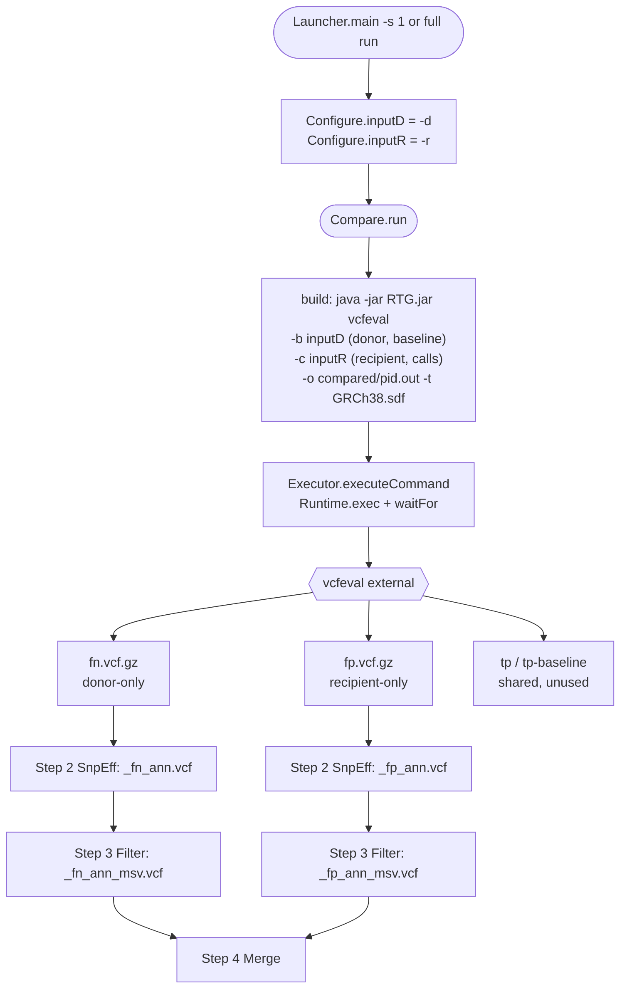

# Step 1 — `command.Compare` (donor vs recipient VCF comparison)

Runs RTG Tools `vcfeval` with the **donor VCF as baseline** and the **recipient VCF as calls**.
The result files `fn.vcf.gz` (donor-only variants) and `fp.vcf.gz` (recipient-only variants)
feed the rest of the pipeline. This document expands section "Step 1" of `PROJECT_SUMMARY.md`
and answers one question precisely: **which VCF do the `fn` and `fp` variants come from?**

> Source note: derived from `command/Compare`, `util/{Executor, FileHelp}`, `nmdp/{Launcher, Configure}`,
> `command/{SnpEff, Filter, Merge}`, `analysis/{MergeTool, SNPdata, ProcessVcf, Transcript}`.
> Nothing was executed. `analysis.Patient` is not in the tree (inferred from usage).
> Step 1 itself contains **no comparison logic in Java**: genotype matching is done entirely
> by the external `vcfeval` tool. Statements about `vcfeval` internals come from general knowledge
> of RTG Tools, not from this repository, and are marked "(external)".

---

## 1. Short answer

| Set | File | Comes from | Meaning in the code |
|---|---|---|---|
| `fn` | `<o>/output/compared/<pid>.out/fn.vcf.gz` | **Donor VCF** (`-d`, passed as `-b`) | Baseline (donor) variants NOT matched by the recipient: donor has it, recipient lacks it (or has a different genotype) |
| `fp` | `<o>/output/compared/<pid>.out/fp.vcf.gz` | **Recipient VCF** (`-r`, passed as `-c`) | Called (recipient) variants NOT matched by the donor: recipient has it, donor lacks it (or has a different genotype) |

Evidence:
- `Compare.java:16-19` builds `vcfeval -b <Configure.inputD> -c <Configure.inputR>`. `-b` is the baseline, `-c` the calls (external, vcfeval convention).
- `Launcher.java:73-74`: `Configure.inputD = -d`, `Configure.inputR = -r`.
- In vcfeval, `fn` = baseline records with no match in calls; `fp` = call records with no match in baseline (external). So `fn` records are literally lines of the donor file and `fp` records are literally lines of the recipient file.
- `MergeTool` confirms this reading: records read from the `fp` file are tagged `Patient.Reciepor`, records from the `fn` file are tagged `Patient.Donor` (see section 6, where an argument-order swap makes the names look inverted but the tags correct).

Direction of mismatch: `fn` = donor-has / recipient-lacks; `fp` = recipient-has / donor-lacks.

---

## 2. Purpose

Find the loci where the donor and recipient genomes differ, as two separate sets, so that later
steps can build the peptide that the **recipient** carries and the donor does not (the candidate
minor histocompatibility antigen). Steps 2 and 3 annotate and keep missense changes; Step 4 merges both
sets and orients every variant so that "alt" is the recipient allele (section 7).

---

## 3. CLI usage and options

```
java -cp <classes> nmdp.Launcher \
     -d <donor.vcf.gz> -r <recipient.vcf.gz> -pid <pairId> -o <outputFolder> \
     -t <toolFolder> -hla A02:01,A02:01,B07:02,B14:02,C07:02,C08:02 -sex <MM|MF|FM|FF> -s 1
```

| Option | Needed by Step 1? | Use |
|---|---|---|
| `-d` | yes | donor `.vcf.gz` (index in the same folder, per help text `Launcher.java`) -> `Configure.inputD` -> `-b` |
| `-r` | yes | recipient `.vcf.gz` -> `Configure.inputR` -> `-c` |
| `-pid` | yes | names the output folder `<pid>.out` |
| `-o` | yes | output root; everything is under `<o>/output/` |
| `-t` | yes (default exists) | tool folder holding `RTG.jar` and `rtg-tools-3.6.2/GRCh38.sdf` |
| `-hla`, `-sex` | only to start | `Launcher` always calls `setHLA` / `setSex` before dispatching a step; a bad `-hla` prints "HLA is not set up properly." and returns; a missing `-sex` is not guarded here |
| `-s 1` | optional | run only Step 1; without `-s` it is the first of 8 steps (`Launcher.java:92`, `:118`) |

Generated command (`Compare.java:15-23`, one line):

```
java -jar <tool>/RTG.jar vcfeval  -b <inputD> -c <inputR> -o <o>/output//compared/<pid>.out -t <tool>/rtg-tools-3.6.2/GRCh38.sdf
```

Notes: the command is executed as a single string through `Runtime.exec(String)`, so paths with spaces
will be split into separate arguments. vcfeval requires that the `-o` directory does not already exist (external),
and `FileHelp.makeFolders()` only creates `compared/`, not `<pid>.out`, so a re-run with the same pid fails inside vcfeval.
Reference is hard-coded to GRCh38 (hg19 line commented out, `Compare.java:25`).

---

## 4. Inputs and outputs

Inputs
- Donor VCF (`-d`) and recipient VCF (`-r`), bgzipped and indexed, GRCh38.
- RTG SDF reference `GRCh38.sdf`.

Outputs (`FileHelp.getVcfevalPath()` = `<o>/output//compared/<pid>.out`, `FileHelp.java:74`)

| File | Produced by | Consumed by |
|---|---|---|
| `fn.vcf.gz` | vcfeval | `FileHelp.getSnpeffInputFn()` (`FileHelp.java:78-79`) -> Step 2 -> `<pid>_fn_ann.vcf` |
| `fp.vcf.gz` | vcfeval | `FileHelp.getSnpeffInputFp()` (`FileHelp.java:82-83`) -> Step 2 -> `<pid>_fp_ann.vcf` |
| `tp.vcf.gz`, `tp-baseline.vcf.gz`, `summary.txt`, `snp_roc.tsv.gz`, etc. | vcfeval (external) | not referenced anywhere in the Java code |

Both consumed files keep the original record layout (VCF text, tab separated), with the sample columns of
the file they came from (donor for `fn`, recipient for `fp`; external).

Downstream naming (for traceability): `…/annotated/<pid>_{fn,fp}_ann.vcf` (Step 2, `SnpEff.java:25,39`),
`…/missense/<pid>_{fn,fp}_ann_msv.vcf` (Step 3, `Filter.java:29`).

---

## 5. Step-by-step algorithm

1. `Launcher.main` parses flags; sets `Configure.inputD`, `inputR`, pair id, tool, output folder; creates folders.
2. `Compare.run()` builds the vcfeval command string (donor `-b`, recipient `-c`).
3. `Executor.executeCommand` prints it, calls `Runtime.exec`, then `waitFor()` (`Executor.java`). Its output streams are not read and the exit code is not checked.
4. vcfeval (external) normalises/matches variants between the two files by position, alleles and genotype
   and writes `tp`, `fn`, `fp`.
5. Nothing else happens in Step 1; Step 2 reads `fn.vcf.gz` and `fp.vcf.gz`.



---

## 6. How the fn / fp provenance is carried to Step 4

`Merge.run()` (`Merge.java:28-29, 37-40`):

```java
File input1 = new File(FileHelp.getMissenseFp());   // actual fp file (recipient-only)
File input2 = new File(FileHelp.getMissenseFn());   // actual fn file (donor-only)
mt.merge(input1, input2, output);
```

But the signature is `MergeTool.merge(File fn, File fp, File output)` (`MergeTool.java:20`). So the
**first argument, named `fn` inside `MergeTool`, is really the fp (recipient-only) file**, and the second, named `fp`, is really the fn (donor-only) file.
`setScanner(fn, fp)` (`:25`, `:144-147`) keeps this swap: `snFn` scans the recipient-only file, `snFp` scans the donor-only file.

| `MergeTool` identifier | Real file | Method | Tag | Treatment |
|---|---|---|---|---|
| `readFn` / `addFnData` (`:114`, `:136-141`) | `_fp_ann_msv.vcf` (recipient-only, vcfeval fp) | stored per chromosome in `fnData` | `Patient.Reciepor` (`:138`) | kept as is, no swap |
| `readFp` / `addFpData` (`:62`, `:83-110`) | `_fn_ann_msv.vcf` (donor-only, vcfeval fn) | compared with stored records | `Patient.Donor` (`:90`) | `ref`/`alt` swapped (`:96`, `:108`) |

So the names `fn`/`fp` inside `MergeTool` are inverted relative to vcfeval, and the doc comments there
("Add all recipient data" on `addFnData`) match the real origin only because of that swap. The final tags are correct:
**`Donor` = variant from the donor-only (vcfeval fn) file; `Reciepor` (sic) = variant from the recipient-only (vcfeval fp) file.**
This is the only place where the code is ambiguous about naming; it is not a functional bug as long as the call order in `Merge.java` is kept.
(`Merge.main`, `Merge.java:58-59`, uses the same fp-first / fn-second order as `Merge.run`. `MergeTool.main` passes the real `fn` file first, which would reverse the roles. `launcherMerge` was not re-checked for this doc.)

---

## 7. Truth table: genotype -> fn / fp / neither

Java does not inspect genotypes. The table below is the behaviour of vcfeval in its default genotype-aware mode (external);
please confirm against your vcfeval version and options. `0` = reference allele, `A` = alt allele, `B` = a different alt allele.

| Donor GT | Recipient GT | vcfeval result | Appears in | Passes to Step 4 as |
|---|---|---|---|---|
| 0/0 (or absent) | 0/0 (or absent) | nothing | none | none |
| A/A or 0/A | 0/0 (or absent) | donor record is FN | `fn` | `Donor`, swapped |
| 0/0 (or absent) | A/A or 0/A | recipient record is FP | `fp` | `Reciepor`, not swapped |
| 0/A | 0/A | TP | neither | none |
| A/A | A/A | TP | neither | none |
| 0/A | A/A | genotype mismatch: donor FN and recipient FP (same alt) | both | both reach `MergeTool`; same-position dedup keeps the donor one (section 8) |
| A/A | 0/A | genotype mismatch (same alt) | both | same as above |
| A/A or 0/A | B/B or 0/B (same position) | different alleles | `fn` (donor A) and `fp` (recipient B) | both reach `MergeTool`; section 8 keeps one record with ref=donor allele, alt=recipient allele |

Chromosome / position matching: done by vcfeval (external). In the Java code only `MergeTool` compares positions
(`ref.pos == data.pos`, `MergeTool.java:91`, within the same chromosome list). Zygosity (hom/het) is not read by any Java code.
Filters: the Java code does not pass any vcfeval filter options (no `--all-records`, `--squash-ploidy`, `--sample`, etc.), so vcfeval defaults apply (external):
only records with FILTER `PASS`/`.` are used and the first sample column is compared.

---

## 8. What later steps do with the fn / fp split

- Step 2 annotates each file independently (`SnpEff.java:18-25` for fp, `:33-39` for fn). The `ANN` text describes the change `REF -> ALT` of the **original** record (for `fn`: reference -> donor allele).
- Step 3 keeps lines containing `missense_variant` (`Filter.java:29`).
- Step 4, `MergeTool` (position collisions within a chromosome):
  - Record only in recipient-only file (vcfeval fp): kept unchanged, so `alt` = recipient allele.
  - Record only in donor-only file (vcfeval fn): `data.swap()` (`MergeTool.java:108`; `SNPdata.java:41-47`) exchanges REF and ALT columns, so `ref` = donor allele, `alt` = reference allele, which is what the recipient carries. The final `alt` is therefore always the recipient-side allele.
  - Same position in both files with **different alt** (`:93-98`): `data.ref = ref.alt` (recipient alt) then `swap()` gives ref = donor alt, alt = recipient alt; the stored recipient record is removed and the donor record, tagged `Donor`, is written.
  - Same position and **same alt** (genotype mismatch): the recipient record is removed (`:105`) and the swapped donor record written (`:108`), so the `alt` becomes the reference allele. See caveat 4.
- `GenerateOutput` then uses `gene.ref`/`gene.alt` for the "ref"/"alt" proteins (`GenerateOutput.java:113-117`).

GvHD relevance: the pipeline builds peptides that the recipient's cells can present and the donor's T cells have not been
tolerised to. The recipient-side allele ends up in the `alt` column in all cases above, and the HLA alleles used downstream are
supplied with `-hla`; the help text does not say whose HLA this is (see caveat 6). The `-sex` help text says "FM = female donor to male recipient",
which fits a donor -> recipient (GvHD) direction, with Y-chromosome proteins exported only for FM.

---

## 9. Caveats, bugs and ambiguities

1. **Inverted names in `MergeTool`.** Because `Merge.run` passes (fp, fn) into `merge(fn, fp, …)`, identifiers `fn`/`fp` inside `MergeTool` are the opposite of vcfeval's. Tags (`Donor`/`Reciepor`) are correct. `MergeTool.main` (`:155-158`) passes `fn` first and would therefore tag the opposite way.
2. **`Patient` not in the tree.** `analysis.Patient` (`Donor`, `Reciepor`, `getID()`) is missing; the exact string written by `getID()` is unknown. The tag is appended to the VCF line as `|<ID>` (`SNPdata.java:38`).
3. **Tag may never be used.** `ProcessVcf` never calls `Transcript.setPatient`, yet `Transcript.getInfo()` calls `patient.getID()` (`Transcript.java:56-62`). Per the code as present this would dereference null; either a missing class/version difference or an unfinished path. Not verified by running.
4. **Genotype-mismatch loci (same alt in fn and fp).** In that case the code keeps the swapped donor record, so `alt` becomes the reference allele (and the recipient-allele record is discarded). The recipient's true variant allele is then in `ref`. This is probably unintended for hom-vs-het differences; confirm with test data.
5. **`setPatient` inside the loop** (`MergeTool.java:90`): the tag is appended once per comparison with a stored record; when the chromosome list is empty it is never appended, so such records (and their `patient` field) are untagged, and when the list has N records the line gets N copies of `|ID`.
6. **Direction is by convention only.** Nothing in the Java code states that `-hla` belongs to the recipient; the help text mentions only `-d`, `-r`, and the sex combination (donor first, recipient second). The direction donor-only/recipient-only is determined entirely by `-b`/`-c` order in `Compare.java:16-19`.
7. **Only SNV-like parsing downstream.** `MergeTool` compares `pos` and `alt` strings only; indels or multi-allelic ALT (`A,B`) are not handled specially. `SNPdata` requires `chrN` style names (`charAt(3)`): `chrM` would throw in `Integer.parseInt`; contigs without `chr` prefix are misparsed.
8. **Empty missense file.** `readFn`/`readFp` (`:114`, `:62`) pass the last read line to `SNPdata` even when the file has no records, which would throw.
9. **Executor limitations.** `Executor` neither captures output nor checks exit status (`Executor.java`), so a failed vcfeval (e.g. existing output folder, missing index) leaves Step 2 to fail later on a missing `fn.vcf.gz`.
10. **Misspellings** carried from source: `Reciepor`, `clevage`, `_protien.fasta`.
