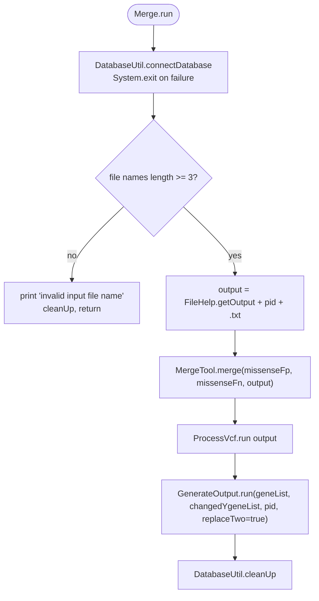
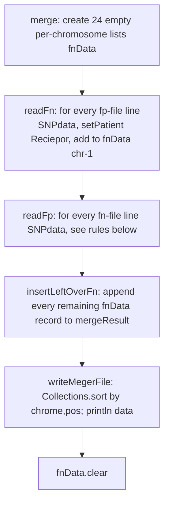
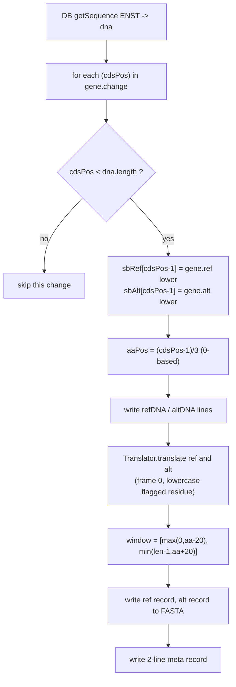
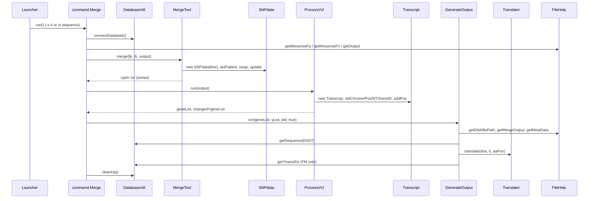
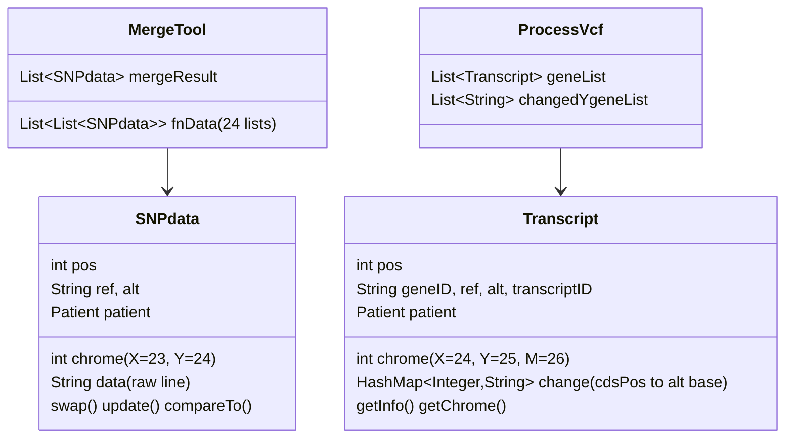

# Step 4 — `command.Merge` (the analysis core)

Merges fp+fn missense variants, parses them into transcripts, and generates
ref/alt protein FASTA (plus DNA dumps and a metadata file). This document
expands section "Step 4" of `PROJECT_SUMMARY.md`.

> Source note: everything below is derived from the `.java` files in
> `MiHAIP/src`: `command/Merge`, `analysis/{MergeTool, SNPdata, ProcessVcf,
> Transcript, GenerateOutput, Gene, NT}`, `translate/Translator`,
> `database/DatabaseUtil`, `nmdp/{Launcher, Configure, launcherMerge}`,
> `util/FileHelp`, `command/{CommandHelper, Cleavage, Chop}`,
> `clevage/Clevage` (for the hand-off). Nothing was executed. The class
> `analysis.Patient` is not in the tree, so its behaviour is inferred from usage.

---

## 1. Purpose

Turn the two missense-only VCFs from Step 3 (donor-only and recipient-only
variants) into paired **reference / alternative protein fragments**: for each
missense SNV, a window of up to 41 amino acids (20 on each side of the changed
residue) is written twice, once with the "ref" allele and once with the "alt"
allele. These FASTA records are the input of Step 5 (netChop) and Step 6
(peptide chopping).

Stages inside `Merge.run()`:

| Stage | Class | Result |
|---|---|---|
| a. merge | `analysis.MergeTool` | one position-sorted text file, `<pid>.txt` |
| b. parse | `analysis.ProcessVcf` | `List<Transcript> geneList`, `List<String> changedYgeneList` |
| c. generate | `analysis.GenerateOutput` | ref/alt DNA, protein FASTA, meta file, optional Y proteins |

---

## 2. CLI usage

Step 4 has no entry point of its own. It is `case 4` of `nmdp.Launcher`:

```
java -cp <classes+sqlite-jdbc> nmdp.Launcher \
     -pid <pairId> -o <outputFolder> -hla A02:01,A02:01,B07:02,B14:02,C07:02,C08:02 \
     -sex <MM|MF|FM|FF> -s 4
```

Without `-s` it runs as the 4th of 8 steps (`new Merge().run()` after `Filter`).

| Option | Needed by Step 4? | Use |
|---|---|---|
| `-pid` | yes | file names: `<pid>.txt`, `<pid>_refDNA.txt`, `<pid>_protien.fasta`, `<pid>_meta.txt` |
| `-o` | yes | root; everything goes under `<o>/output/` (`FileHelp.getOutput()`) |
| `-sex` | yes | `Launcher` always calls `Configure.setSex(...)`; a missing `-sex` gives an NPE (`null.toUpperCase()`). Value `FM` also switches on Y-protein export |
| `-hla` | yes (to start) | `Configure.setHLA` is always called; missing `-hla` prints "HLA is not set up properly." and exits. Not otherwise used by Step 4 |
| `-d`, `-r`, `-t` | no | used by Steps 1, 2, 5, 7 |
| `-s 4` | optional | run only this step |

Runtime requirements:
- `cds.db` (SQLite) in the **current working directory** (`jdbc:sqlite:cds.db`), table `cds_sequence`, plus the SQLite JDBC driver on the classpath. If the file is missing SQLite silently creates an empty one (see Caveats).
- `<o>/output/missense/<pid>_fp_ann_msv.vcf` and `..._fn_ann_msv.vcf` from Step 3.
- Output folders come from `FileHelp.makeFolders()`, which `Launcher` calls before any step.

Alternative entry points (not used by the pipeline):
- `nmdp.launcherMerge.main(args)` takes two input files, runs the same three stages, but passes an **empty** Y list and never sets `Configure` (pair id / output would be null).
- `Merge.main` and `MergeTool.main` are developer tests with hard-coded `/Users/wwang/...` paths.

---

## 3. Inputs

| Input | Path (`FileHelp`) | Format |
|---|---|---|
| fp missense VCF | `getMissenseFp()` = `<o>/output/missense/<pid>_fp_ann_msv.vcf` | SnpEff-annotated VCF lines containing `missense_variant` |
| fn missense VCF | `getMissenseFn()` = `<o>/output/missense/<pid>_fn_ann_msv.vcf` | same |
| CDS sequences | `cds.db`, `cds_sequence` | looked up by `TRANSCRIPT_ID`, column `SEQ` = CDS nucleotides (5'→3') |
| Sex | `Configure.getSex()` | `FM` enables Y handling |

Expected line layout (checked by the parsers):

```
chrN <TAB> POS <TAB> ID <TAB> REF <TAB> ALT <TAB> ... INFO;ANN=ALT|missense_variant|MODERATE|GENE|GENEID|transcript|ENST...|protein_coding|rank|c.1234A>G|p.Xxx45Yyy|...|
```

Field use (after `split("\t")` and `split("\\|")` on the first ANN entry):

| Parser | Field | Meaning |
|---|---|---|
| `SNPdata` / `ProcessVcf` | tab col 0 | `chrN` (needs the `chr` prefix; `substring(3)`/`charAt(3)`) |
| | tab cols 1, 3, 4 | POS, REF, ALT |
| `ProcessVcf` | `detail[3]` | gene name, kept as `geneID` |
| | `detail[6]` | transcript ID (`ENST…`) |
| | `detail[9]` | HGVS.c; first digit run = CDS position (1-based) |

`Filter` (Step 3) drops all `#` header lines, so these files normally have no headers.

---

## 4. Outputs

| File | Path | Content |
|---|---|---|
| merged variants | `<o>/output/<pid>.txt` | merged, sorted VCF lines, ref/alt rewritten, `\|<patientId>` suffix |
| ref DNA | `<o>/output/DNA/<pid>_refDNA.txt` | one line per `Transcript` |
| alt DNA | `<o>/output/DNA/<pid>_altDNA.txt` | same, with alt base |
| **protein FASTA** | `<o>/output/protein/<pid>_protien.fasta` (`getMergeOutput`) | 2 records (ref, alt) per mutation |
| **meta** | `<o>/output/meta/<pid>_meta.txt` (`getMetaData`) | 2 lines per mutation |
| Y proteins (FM only) | `<o>/output/Yprotein/<pid>yProtein.txt` | unchanged Y-chromosome proteins |

### FASTA record format

```
>chr<C>|<genomicPos>|<geneName>|<patientId>|<ENST>|<aaPos1based>
<ref window, 1 to 41 aa>
>chr<C>|<genomicPos>|<geneName>|<patientId>|<ENST>|<aaPos1based>
<alt window, same range>
```

- `<C>` is `1`–`22`, `X`, `Y` or `M` (from `Transcript.getInfo()`, which maps 24/25/26).
- The changed residue is **lowercase** in the window (e.g. `…LKPGkTEEL…`); `Translator.translate(dna, 0, aachangePos)` lowercases it.
- `<patientId>` is `Patient.getID()` (class not in tree).
- The header is identical for the ref and alt record; position in file (first = ref, second = alt) is what pairs them.

### Meta file format (2 lines per mutation, same order as FASTA pairs)

```
chr<C>,<genomicPos>,<refBase>,<altBase>,<cdsPos>,<ENST>,
<indexOfMutatedResidueInWindow>
```

`refBase` / `altBase` are the lowercase bases taken back from the edited DNA at `cdsPos`. The second line is the 0-based index of the mutated residue in the window: `20` if the window is a full 41 aa (`end-start==40`), `aa` if the window starts at 0, otherwise `aa-start`.

### DNA files

```
>chr<C>|<pos>|<gene>|<patientId> <ENST> ,<cdsPos>,<fullCdsWithLowercaseBase>
```

(The text after the transcript ID is `" ,"` then each CDS position followed by `","`, then the sequence.)

### Y-protein file

```
>chrome Y |<ENST>|
<full translation of the transcript, frame 0>
```

---

## 5. Algorithm, step by step

### 5.1 Overall flow



### 5.2 Merging fp + fn (`MergeTool`)

Parameter naming is easy to misread. `MergeTool.merge(File fn, File fp, File output)`,
but `Merge.run` calls `mt.merge(input1 = missenseFp, input2 = missenseFn, …)`.
So inside `MergeTool`:

| Inside `MergeTool` | Actual file | Label | Method |
|---|---|---|---|
| "fn" scanner | **fp** missense VCF | `Patient.Reciepor` | `readFn` → `addFnData` |
| "fp" scanner | **fn** missense VCF | `Patient.Donor` | `readFp` → `addFpData` |

With Step 1 (`vcfeval -b donor -c recipient`) fn = variants only in the donor, fp = variants only in the recipient, so the labels line up with the biology. Note that `MergeTool.main` passes the files in the opposite order.



Rules in `addFpData` (donor record `data`, compared with each recipient record `ref` on the same chromosome list):

| Case | What happens |
|---|---|
| no recipient record at same `pos` | donor record: `swap()` (REF↔ALT) and added |
| same `pos`, **different** `alt` | `data.ref = ref.alt; data.swap()` → final **REF = donor ALT, ALT = recipient ALT**; recipient record removed; method returns |
| same `pos`, **same** `alt` | recipient record removed (after the loop); donor record `swap()`ped and added |
| recipient record never matched | stays unchanged and is appended by `insertLeftOverFn` |

Net effect on the merged file: the `REF` column holds the **donor allele** and `ALT` holds the **recipient allele**.
- Donor-only line: original REF/ALT swapped (REF=donor's variant, ALT=genome reference).
- Recipient-only line: unchanged (REF=genome reference, which is the donor's allele there; ALT=recipient's variant).
- Both at same position: REF=donor ALT, ALT=recipient ALT.

`SNPdata` details:
- chromosome: `X`/`x` → 23, `Y`/`y` → 24, otherwise `Integer.parseInt(substring(3))`. List index is `chrome - 1` (24 lists).
- `swap()` calls `update()`, which re-splits `data` on tabs, overwrites columns 3 and 4, and re-joins with a tab after **every** field (so rewritten lines end with a trailing tab).
- `setPatient(p)` appends `"|"+p.getID()` to the line text.
- `compareTo`: chromosome, then position. `Collections.sort` is stable.

### 5.3 Transcript parsing (`ProcessVcf`)

For each line of `<pid>.txt` (`processLine`):
1. `s.split("\\|,")` splits SnpEff ANN entries; only `trans[0]` is used, split on `|`.
2. `detail[0].split("\t")` → `basic`. Chromosome: `charAt(3)-'0'` maps `X`→40→24, `Y`→41→25, `M`→29→26; everything else uses `Integer.parseInt(substring(3))`.
3. `pos = basic[1]`, `transcript = detail[6]`.
4. If chromosome is 25 (Y) and `Configure.getSex()==FM`, the transcript ID goes to `changedYgeneList`.
5. New `Transcript(transcript)`: `chrome`, `pos`, `setNT(basic[3], basic[4])` (ref/alt after merging), `setGeneID(detail[3])`.
6. `DNAchange = getNumber(detail[9])` = first digit run of the HGVS.c string (`c.1234A>G` → 1234). A parse failure prints `data is not number …` and leaves 0.
7. `gene.addPos(DNAchange, gene.getAlt())` → `change{cdsPos → altBase}`.
8. Regex `ENST(.)*p.` is matched against the whole line and only the first match is processed (`break`). `processTrans` splits it on `|` and re-reads `detail[3]` (HGVS.c) for transcript `detail[0]`. If that ID equals the current transcript it just re-adds the same position; otherwise a new `Transcript` is created with `setInfo(gene)` (copies chrome/pos/ref/alt/patient) and added.

Because the regex starts at the first `ENST` on the line, which is the first ANN entry, the "other transcript" branch is effectively not reached. Combined with the `-canon` flag used in Step 2, each line yields one `Transcript`.

**Each VCF line creates its own `Transcript`**, even if the same transcript ID already occurs. Variants are never grouped by transcript.

### 5.4 Ref/alt protein generation (`GenerateOutput`)

`run(geneList, yGeneList, pid, true)` opens the four writers (`setPrinters`), calls `processGene` for each `Transcript`, then `processYgenes` if sex is `FM` and `yGeneList` is non-empty, then closes writers.



How the mutation is applied:
- `replaceTwo=true` (what `Merge.run` passes): the reference DNA is **not** the database base; it gets `gene.ref` (the donor allele from the merged file) at `cdsPos-1`, and the alt DNA gets `gene.alt` (recipient allele). With `replaceTwo=false` the ref copy would only lowercase the database base.
- Substitutions use `StringBuilder.replace(i-1, i, allele)`; the database base is not compared with `gene.ref`.
- `Translator.translate`: codons from frame 0 in steps of 3 while `i+2 < length` (a trailing partial codon is dropped). Stop codons give `*` and translation continues past them. Unknown codons use the first-two-base rule (4-fold degenerate), else `X`. Lowercase is applied when `sb.length() == lowcase.get(0)`, then the entry is removed.
- Window: `start=max(0, aa-20)`, `end=min(refProtein.length()-1, aa+20)`; the same `start/end` is applied to the alt protein.

Y handling (`FM` only): `processYgenes` fetches all Y transcript IDs from the DB (`CHROME='Y'`), removes IDs that were hit by a variant, and translates the rest in full to `Yprotein/<pid>yProtein.txt`.

### 5.5 Edge cases as coded

| Situation | Behaviour |
|---|---|
| change at last CDS base (`cdsPos >= dna.length()`) | skipped (strict `<`); the DNA lines are still written |
| transcript not in DB | `getSequence` returns `""`; DNA lines written with empty sequence; no FASTA/meta |
| window near N-terminus | `start=0`; meta index = `aa` |
| window near C-terminus | `end=len-1`; meta index = `aa-start` |
| two lines on same chromosome/pos, different alt | one merged line (donor-vs-recipient alleles) |
| header-only or empty input file | `readFn`/`readFp` pass the last header line (or `""`) to `SNPdata` → exception |
| non-numeric chromosome (`chrM`, `chr1_KI…`) in `SNPdata` | `NumberFormatException` |
| `HGVS.c` without digits | `getNumber` runs off the string → exception caught only in `ProcessVcf` try/catch, leaves 0 |
| input file missing | `Scanner` error printed, then NPE on the null scanner / `PrintWriter` |

---

## 6. Class / method call flow



---

## 7. Data structures



- `MergeTool.fnData` — 24 lists of recipient (fp-file) records, consumed as donor records match them.
- `MergeTool.mergeResult` — final record list, sorted by `(chrome, pos)`.
- `Transcript.change` — `HashMap<cdsPos, altBase>`; in practice one entry.
- `analysis.Gene` and `analysis.NT` are not used by Step 4.
- `Configure` static state: `pairID`, `output`, `sex`.

---

## 8. Hand-off to Step 5 (and 6)

- Step 5 (`command.Cleavage`) runs `netChop -s -v 1 <FileHelp.getMergeOutput()>` on the FASTA written here and saves stdout to `<o>/output/cleavaged/<pid>_cleavaged.txt`.
- Step 6 (`command.Chop` → `clevage.Clevage.run(meta, cleavage)`) reads:
  - `FileHelp.getMetaData()` (this step): line pairs are `header` / `location`. `location` is the 0-based index of the mutated residue.
  - the netChop output: `findPair()` takes consecutive sequence records as pairs (first = ref, second = alt), so the **ref-then-alt order and the 2-records-per-mutation count** written here must hold.
- `Clevage` uses `location` to keep only 8–11-mers that cover that residue, drops peptides identical in ref and alt, and writes `chopped/<pid>_chopped.pep` + `chopMeta/<pid>.txt` (the meta header line is repeated per peptide).
- The Y-protein file and DNA files are not consumed by later steps (the Y cleavage block in `Cleavage` is commented out).

---

## 9. Caveats and bugs noticed

- **`Patient` is missing** from the tree and `Transcript.patient` is only set through `setPatient`/`setInfo`; `ProcessVcf` never calls `setPatient`. As written, `Transcript.getInfo()` (`patient.getID()`) is called on a null `patient` in `GenerateOutput.processGene`. The `|<ID>` suffix that `MergeTool` adds to the merged lines is not parsed back. Not verified by running; the original build may differ.
- **Argument swap in naming**: `merge(File fn, File fp, …)` is called with (fp, fn) by `Merge.run` and `launcherMerge`, but with (fn, fp) in `MergeTool.main`. The labels (Reciepor/Donor) are only right for the `Merge.run` order.
- **`setPatient` inside the loop** (`addFpData`) appends `|<ID>` once per scanned recipient record; the donor line gets 0..n copies. If there is no recipient record on that chromosome, no suffix and `patient` stays null.
- **Strand (fixed in src)**: strand is derived per variant from ANN HGVS.c vs VCF REF (HGVS.c ref base == REF means plus, == complement means minus; `Transcript.setStrandFromHgvsC`, called from `ProcessVcf`). `GenerateOutput.processGene` now writes the complemented REF/ALT into the CDS for minus-strand transcripts, so record 1 = WT (REF) and record 2 = mutant (ALT) on both strands. The metadata file keeps genomic bases because they feed the frequency lookup. The fix exists only in `src`: the deployed `MiHAIP0.3.3_patched2.jar` (used by `Tools/run_miha.sh`) must be rebuilt and redeployed, then Merge (`-s 4`) and later steps rerun. Non-SNV records keep the old behaviour. The next bullet describes the behaviour before the fix.
- **Strand (before the fix)**: alleles from the VCF are written into the CDS as is (`replace(i-1,i,gene.ref/alt)`); nothing complements them for minus-strand transcripts, and nothing checks that the database base equals `gene.ref`. HGVS.c positions are transcript-relative while REF/ALT are genomic.
- **Non-SNV records**: a multi-base REF/ALT (e.g. an MNV annotated as missense) replaces one base with several, which shifts the frame. The alt substring may then exceed `altProtein` length → exception.
- **One `Transcript` per VCF line**: two missense variants in the same transcript give independent ref/alt pairs; there is no combined haplotype peptide.
- **Lowercase marker order**: `translate(.., lowcase)` only checks `lowcase.get(0)`; if a `Transcript.change` ever held several positions in non-ascending `HashMap` order, some markers would be skipped.
- **Chromosome numbering**: `SNPdata` X=23/Y=24, `ProcessVcf`/`Transcript` X=24/Y=25/M=26. `Transcript.getChrome()` (used in the meta file) maps only 24→`chrX`, 25→`chrY`; chrM would print `chr26`. `SNPdata` cannot parse `chrM`.
- **`Yprotein/` folder** is never created by `FileHelp.makeFolders()` (only `Ycleavaged/` is). For `FM` runs `new PrintWriter(...)` in `processYgenes` would hit `FileNotFoundException` (caught, printed) unless the folder exists.
- **Transcript ID matching**: `getSequence` uses exact equality on `TRANSCRIPT_ID`. `ImportData` previously matched IDs with `ENST\d+\.\d`, which truncated versions of 10 or more (`.10` stored as `.1`) so those transcripts were silently dropped. **Fixed**: the pattern is now `ENST\d+\.\d+`, and `GenerateOutput.processGene` prints a warning to stderr when no sequence is found. An existing `cds.db` built with the old pattern must be rebuilt. `createSeqTable` also declares `UNIQUE(Chrome)`, which looks wrong for a per-transcript table (importer, outside the Step 4 path).
- **Missing `cds.db`**: `connectDatabase` creates an empty database silently; all sequences are `""`, so the FASTA and meta files come out empty without an error.
- **Error handling**: `connectDatabase` calls `System.exit(0)` on failure; `Merge.run` has no try/finally, so an exception skips `DatabaseUtil.cleanUp()`. Scanners in `ProcessVcf.run` and `MergeTool` are never closed. `writeMegerFile` calls `pw.close()` outside its null check.
- **SQL by concatenation** in `getSequence` (transcript ID from the VCF). Treat inputs as trusted.
- **Protein includes stop codons** (`*`) and keeps translating; the window can contain `*`.
- Misspellings are original: `_protien.fasta`, `Reciepor`, `writeMegerFile`, `clevage`.
